# TP 2 — Deux machines virtuelles en réseau avec VirtualBox

**Cours :** Introduction au Cloud — L3 SI (BDGL), séance 2
**Étudiant(e) / binôme :** TRA BI TRA Christian David / Kouadio Yao Boffouo Siedou
**Date :** 27-28 octobre 2026

**Machine hôte :** Intel Core i5-6300U (2 cœurs, 4 processeurs logiques), 16 Go de RAM, Windows 11
**Logiciels :** VirtualBox 7.2.20 (r175154), Ubuntu Server 26.04.1 LTS

> Dans ce compte rendu, les blocs de code montrent les commandes lancées et les sorties obtenues. Les captures d'écran sont dans le dossier `images/`, à côté de ce fichier. L'invite `PS C:\...>` indique une commande lancée dans PowerShell sur l'hôte Windows, et `etudiant@...:~$` une commande lancée dans une VM.

---

## Introduction

Dans le TP précédent, j'ai installé une seule machine virtuelle, `ubuntu-srv`, en partant de zéro. Ce TP montre la suite logique d'une infrastructure cloud : à partir de cette machine servant d'**image**, on crée **plusieurs machines identiques** (des clones), on les **relie dans un réseau privé**, on **publie un service** (un serveur web) et on le **protège** avec un pare-feu.

**Objectifs :**
- créer deux VM, `web` et `client`, par clonage, et les personnaliser (nom, identité, adresse IP fixe) ;
- les relier dans un réseau privé `tp-cloud` et tester leur connectivité ;
- installer Nginx sur `web`, le rendre accessible depuis l'hôte, puis le bloquer et le rouvrir avec `ufw` ;
- mesurer les ressources réellement consommées, puis tout nettoyer.

**Architecture mise en place :**

```
PC hôte (Windows 11)
   127.0.0.1:2222 --> SSH vers web       127.0.0.1:2223 --> SSH vers client
   127.0.0.1:8080 --> HTTP vers web
            |
            v
  Réseau NAT "tp-cloud"  10.10.0.0/24  (sans DHCP, passerelle 10.10.0.1)
  +------------------------+         +------------------------+
  |  web     10.10.0.10    | <-----> |  client   10.10.0.20   |
  |  Nginx (80), SSH (22)  |         |  SSH (22)              |
  +------------------------+         +------------------------+
            |
            +--> sortie vers Internet (NAT)
```

## Plan du compte rendu

1. Termes importants
2. Partie 1 : créer les VM par clonage
3. Partie 2 : relier les VM en réseau
4. Partie 3 : publier une page web et la protéger
5. Partie 4 : mesurer et nettoyer
6. Difficultés rencontrées et solutions
7. Lien avec le cloud
8. Aide-mémoire des commandes
9. Conclusion

## Termes importants

| Terme | Définition | Dans ce TP |
|---|---|---|
| **Cloud IaaS** | Le fournisseur loue de l'infrastructure (machines virtuelles, réseau, stockage) à la demande ; le client gère le système et tout ce qui est au-dessus. | VirtualBox joue le fournisseur |
| **Hyperviseur de type 2** | Logiciel qui crée et fait tourner des machines virtuelles en s'exécutant sur un système hôte (le type 1 tourne directement sur le matériel). | VirtualBox sur Windows |
| **Machine virtuelle (VM)** | Ordinateur simulé par logiciel, avec ses propres processeurs, RAM, disque et carte réseau virtuels. | `web`, `client` |
| **Image (AMI)** | Modèle figé d'une machine (système et configuration) à partir duquel on lance autant d'instances qu'on veut. | `ubuntu-srv` |
| **Clone / instance** | Copie créée à partir de l'image. Ici ce sont des clones complets : chacun a ses propres données. | `web`, `client` |
| **Réseau NAT (NAT Network)** | Réseau privé virtuel où les VM se voient entre elles et sortent vers Internet, sans être joignables de l'extérieur. | `tp-cloud` |
| **Adresse IP, sous-réseau, masque /24** | L'IP identifie une machine sur un réseau. Le masque /24 réserve les 24 premiers bits au réseau : toutes les adresses en 10.10.0.x sont dans le même sous-réseau (254 adresses utilisables). | 10.10.0.10 et 10.10.0.20 |
| **Passerelle par défaut** | Routeur vers lequel on envoie les paquets destinés à un autre réseau. | 10.10.0.1 |
| **DHCP** | Service qui distribue automatiquement les adresses IP. Il est désactivé ici : on fixe les adresses à la main. | `--dhcp off` |
| **DNS et `/etc/hosts`** | Le DNS traduit un nom en adresse IP ; `/etc/hosts` est un petit annuaire local qui fait la même chose pour quelques noms. | `10.10.0.10 web` |
| **Redirection de port** | Règle qui envoie ce qui arrive sur un port de l'hôte vers un port d'une VM. | 2222 vers 10.10.0.10:22 |
| **Port et service** | Le numéro de port désigne un service sur une machine (22 : SSH, 80 : HTTP). | SSH, Nginx |
| **SSH et clés d'hôte** | SSH est une connexion à distance chiffrée ; les clés d'hôte prouvent l'identité du serveur. | `ssh -p 2222 ...` |
| **Adresse MAC** | Identifiant matériel d'une carte réseau. Un clone reçoit une nouvelle MAC. | cause de l'incident 2 |
| **machine-id** | Identifiant unique d'une installation Linux, utilisé par les journaux et les services. | régénéré sur chaque clone |
| **netplan et YAML** | netplan configure le réseau d'Ubuntu à partir de fichiers YAML. En YAML, l'indentation (les espaces) donne la structure. | `99-tp.yaml` |
| **cloud-init** | Outil qui personnalise automatiquement une instance cloud au premier démarrage (nom, clés, réseau). | fait à la main ici |
| **Nginx** | Serveur web : il écoute sur le port 80 et sert les pages d'un dossier. | `index.html` |
| **Pare-feu (`ufw`) et groupe de sécurité** | Filtre le trafic par port et protocole. `ufw` est dans la VM ; un groupe de sécurité est appliqué par le fournisseur cloud, hors de la VM. | `ufw allow` |
| **ICMP, ping, latence** | Le ping envoie un message ICMP et mesure le temps de réponse (la latence). | 2,738 ms |
| **curl** | Outil en ligne de commande pour envoyer une requête HTTP. Le code retour 28 signifie « délai dépassé ». | port 80 fermé |
| **Encodage UTF-8** | Façon de représenter les caractères. Sans déclaration, le navigateur peut se tromper (`Binôme`). | `meta charset` |
| **Disque dynamique (VDI)** | Fichier disque qui grossit avec les données écrites (*thin provisioning*). | 25 Go annoncés, 6,30 Go réels |
| **Mode headless** | VM démarrée sans fenêtre, comme un serveur de centre de données. | `startvm --type headless` |

---

## Partie 1 — Créer les VM par clonage

### 1.1 Cloner l'image et créer le réseau

**Étape 1 : vérifier qu'aucune VM ne tourne.** `ubuntu-srv` était déjà éteinte, donc `acpipowerbutton` a renvoyé l'erreur attendue (« Machine 'ubuntu-srv' is not currently running ») et `list runningvms` n'a rien affiché.

```
PS> $env:Path += ";C:\Program Files\Oracle\VirtualBox"
PS> VBoxManage list vms
"ubuntu-srv" {1a1fc102-b4b6-49da-8871-fb0dfeafdeea}
PS> VBoxManage controlvm ubuntu-srv acpipowerbutton
VBoxManage.exe: error: Machine 'ubuntu-srv' is not currently running.
PS> VBoxManage list runningvms
(aucune ligne)
```

*Capture 1 : Aucune VM en cours d'exécution*

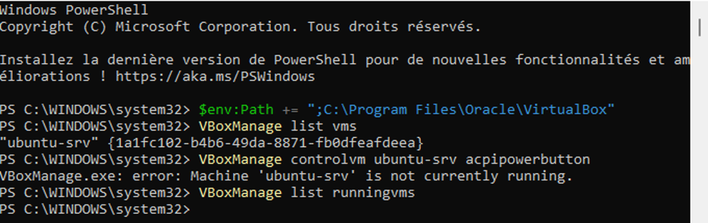

**Étape 2 : cloner `web` (avec chronomètre) puis `client`, et réduire chaque clone à 1 vCPU et 1 Go de RAM.**

```
PS> Measure-Command { VBoxManage clonevm ubuntu-srv --name web --register } | Select-Object TotalSeconds
0%...10%...20%...30%...40%...50%...60%...70%...80%...90%...100%

TotalSeconds
------------
 101,5183704

PS> VBoxManage clonevm ubuntu-srv --name client --register
0%...10%...20%...30%...40%...50%...60%...70%...80%...90%...100%
Machine has been successfully cloned as "client"
PS> VBoxManage modifyvm web    --cpus 1 --memory 1024
PS> VBoxManage modifyvm client --cpus 1 --memory 1024
PS> VBoxManage list vms
"ubuntu-srv" {1a1fc102-b4b6-49da-8871-fb0dfeafdeea}
"web" {e7468458-f837-4360-bc89-b9ad6a345334}
"client" {b2961c06-106d-41f8-8573-eb4cbb1ed73a}
```

Le clonage de `web` a pris **101,5 secondes**. Les trois VM sont visibles dans VirtualBox, toutes éteintes.

*Capture 2 : Clonage de web et client*

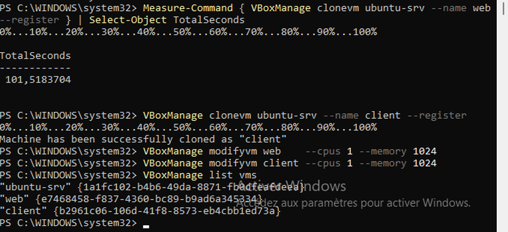

**Étape 3 : créer le réseau NAT `tp-cloud` sans DHCP, avec ses trois redirections de port.**

```
PS> VBoxManage natnetwork add --netname tp-cloud --network "10.10.0.0/24" --enable --dhcp off
PS> VBoxManage natnetwork modify --netname tp-cloud --port-forward-4 "ssh-web:tcp:[127.0.0.1]:2222:[10.10.0.10]:22"
PS> VBoxManage natnetwork modify --netname tp-cloud --port-forward-4 "ssh-client:tcp:[127.0.0.1]:2223:[10.10.0.20]:22"
PS> VBoxManage natnetwork modify --netname tp-cloud --port-forward-4 "http-web:tcp:[127.0.0.1]:8080:[10.10.0.10]:80"
PS> VBoxManage natnetwork list
NAT Networks:

Name:         tp-cloud
Enabled:      Yes
Network:      10.10.0.0/24
Gateway:      10.10.0.1
DHCP Server:  No
IPv6:         No
IPv6 Prefix:  fd17:625c:f037:2::/64
IPv6 Default: No
Port-forwarding (ipv4)
        http-web:tcp:[127.0.0.1]:8080:[10.10.0.10]:80
        ssh-client:tcp:[127.0.0.1]:2223:[10.10.0.20]:22
        ssh-web:tcp:[127.0.0.1]:2222:[10.10.0.10]:22
loopback mappings (ipv4)
        127.0.0.1=2

1 network found
```

*Capture 3 : Réseau NAT tp-cloud*

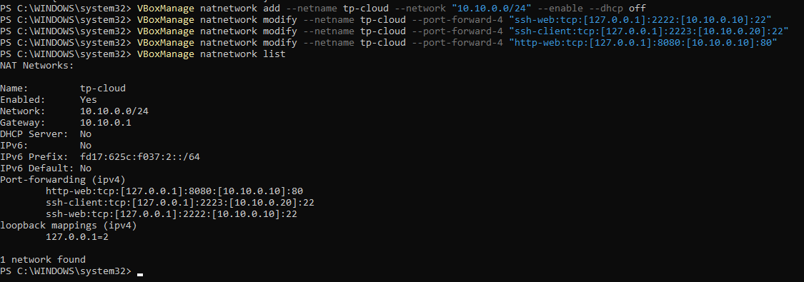

**Étape 4 : brancher la carte réseau 1 de chaque clone sur `tp-cloud`.**

```
PS> VBoxManage modifyvm web    --nic1 natnetwork --nat-network1 tp-cloud
PS> VBoxManage modifyvm client --nic1 natnetwork --nat-network1 tp-cloud
PS> VBoxManage showvminfo web | Select-String "Memory size|Number of CPUs|NIC 1"

Memory size:                 1024MB
Number of CPUs:              1
NIC 1:                       MAC: 080027805C71, Attachment: NAT Network 'tp-cloud', Cable connected: on, ...
```

*Capture 4 : showvminfo web*

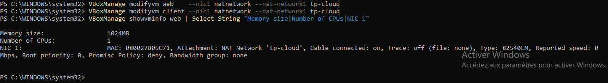

### 1.2 Personnaliser chaque clone

**Étape 5 : nom d'hôte, identifiant de machine et clés SSH de `web`** (console de la VM) :

```
etudiant@ubuntu-srv:~$ sudo hostnamectl set-hostname web
etudiant@ubuntu-srv:~$ sudo sed -i 's/ubuntu-srv/web/g' /etc/hosts
etudiant@ubuntu-srv:~$ sudo rm -f /etc/machine-id && sudo systemd-machine-id-setup
Initializing machine ID from random generator.
etudiant@ubuntu-srv:~$ sudo rm -f /etc/ssh/ssh_host_* && sudo ssh-keygen -A
ssh-keygen: generating new host keys: RSA ECDSA ED25519
```

Le prompt affiche encore `ubuntu-srv` : le nouveau nom n'est pris en compte qu'après le redémarrage.

*Capture 5 : Personnalisation de web*

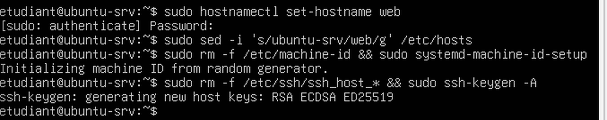

**Étape 6 : adresse fixe `10.10.0.10/24` pour `web` avec netplan.**

*Incident 1 : fichier YAML saisi sans indentation.* Ma première saisie du fichier `/etc/netplan/99-tp.yaml` n'avait pas les espaces d'indentation (et comportait `network :` et `-to:` au lieu de `network:` et `- to:`). Je l'ai annulée avec **Ctrl gauche + C** avant de taper `EOF`, donc rien n'a été écrit. La première fois, j'avais utilisé la **Ctrl droite**, qui est la *touche hôte* de VirtualBox : elle a ouvert une fenêtre d'information (mode redimensionné) et n'a pas annulé la saisie. Le fichier a ensuite été retapé avec l'indentation correcte (2, 4, 6, 8 et 10 espaces selon les niveaux) :

```
etudiant@ubuntu-srv:~$ cat /etc/netplan/99-tp.yaml
network:
  version: 2
  ethernets:
    enp0s3:
      dhcp4: false
      addresses: [10.10.0.10/24]
      routes:
        - to: default
          via: 10.10.0.1
      nameservers:
        addresses: [10.10.0.1, 1.1.1.1]
```

*Incident 2 : `netplan apply` échoue.*

```
etudiant@ubuntu-srv:~$ sudo chmod 600 /etc/netplan/99-tp.yaml
etudiant@ubuntu-srv:~$ sudo netplan apply
Cannot find unique matching interface for enp0s3
etudiant@ubuntu-srv:~$ ip -br link
lo       UNKNOWN   00:00:00:00:00:00 <LOOPBACK,UP,LOWER_UP>
enp0s3   UP        08:00:27:80:5c:71 <BROADCAST,MULTICAST,UP,LOWER_UP>
```

*Capture 6 : Erreur netplan et nom de l'interface*

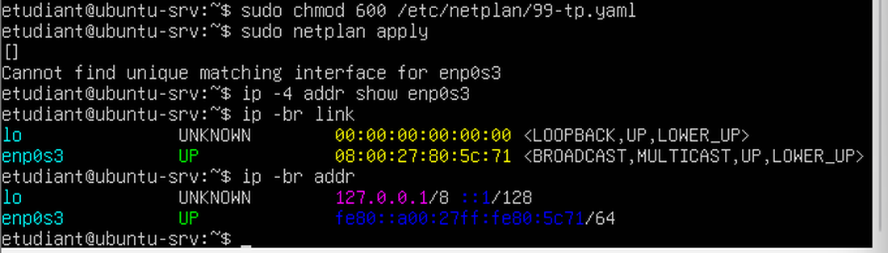

Mon premier réflexe (nom d'interface différent) était faux : la carte s'appelle bien `enp0s3`. En listant les fichiers netplan, j'ai trouvé la vraie cause : le fichier `00-installer-config.yaml`, écrit par l'installateur d'`ubuntu-srv`, contient

```
match:
  macaddress: 08:00:27:0e:93:62
set-name: enp0s3
```

Il désigne la carte par l'**ancienne adresse MAC** d'`ubuntu-srv`. Comme le clone a reçu une nouvelle MAC (`08:00:27:80:5c:71`), aucune carte ne correspond, d'où l'erreur. Le fichier `99-tp.yaml` était correct.

*Capture 7 : Les deux fichiers netplan*

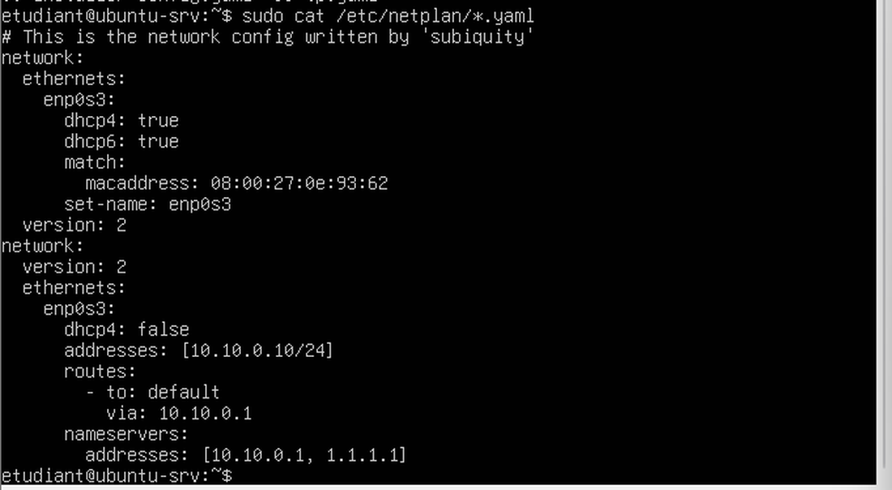

**Solution :** renommer l'ancien fichier en `.bak` (netplan ne lit que les fichiers `.yaml`), puis appliquer :

```
etudiant@ubuntu-srv:~$ sudo mv /etc/netplan/00-installer-config.yaml /etc/netplan/00-installer-config.yaml.bak
etudiant@ubuntu-srv:~$ ls /etc/netplan/
00-installer-config.yaml.bak  99-tp.yaml
etudiant@ubuntu-srv:~$ sudo netplan apply
etudiant@ubuntu-srv:~$ ip -4 addr show enp0s3
2: enp0s3: <BROADCAST,MULTICAST,UP,LOWER_UP> mtu 1500 ... state UP ...
    inet 10.10.0.10/24 brd 10.10.0.255 scope global enp0s3
       valid_lft forever preferred_lft forever
```

*Capture 8 : Adresse 10.10.0.10 appliquée*

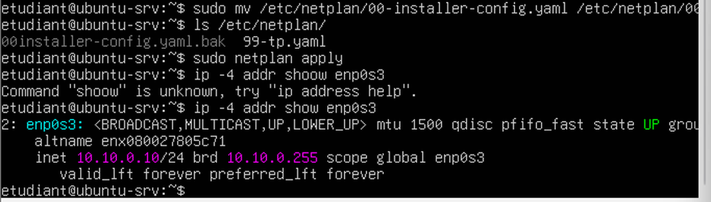

`web` a ensuite été redémarrée (`sudo reboot`).

**Étape 7 : même procédure sur `client`** (nom `client`, adresse `10.10.0.20/24`). Cette fois, j'ai renommé `00-installer-config.yaml` **avant** `netplan apply`, ce qui a évité l'incident 2. Deux fautes de frappe (`99-tp/yaml` et `/etc/netpal`) ont été corrigées aussitôt.

```
etudiant@ubuntu-srv:~$ ip -4 addr show enp0s3
2: enp0s3: <BROADCAST,MULTICAST,UP,LOWER_UP> mtu 1500 ... state UP ...
    inet 10.10.0.20/24 brd 10.10.0.255 scope global enp0s3
```

*Capture 9 : Adresse 10.10.0.20 appliquée sur client*

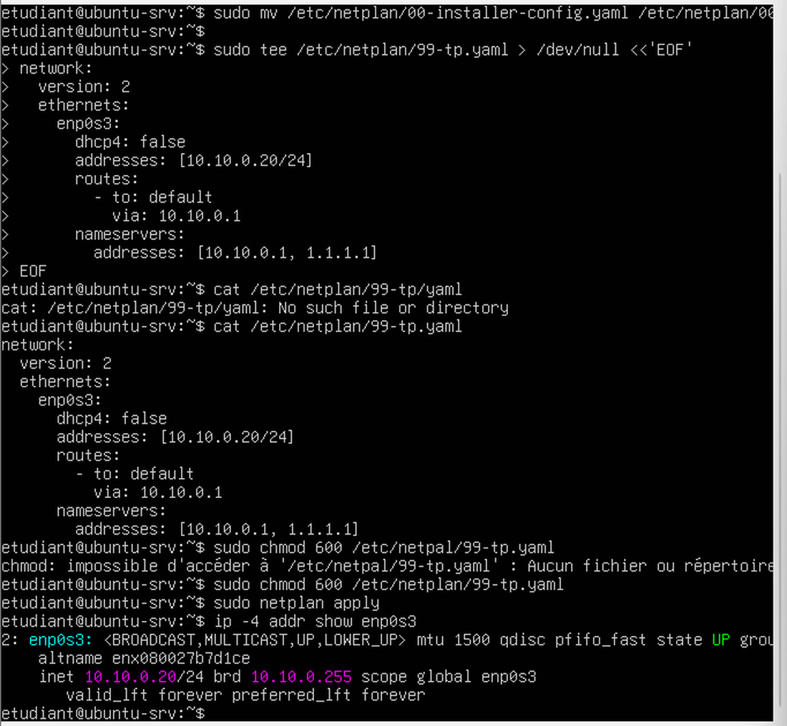

**Étape 8 : connexion SSH aux deux VM depuis l'hôte.**

```
PS> ssh-keygen -R "[127.0.0.1]:2222"
PS> ssh-keygen -R "[127.0.0.1]:2223"
PS> ssh -p 2222 etudiant@127.0.0.1 "hostnamectl; lsb_release -a; uname -r"
The authenticity of host '[127.0.0.1]:2222 ([127.0.0.1]:2222)' can't be established.
Are you sure you want to continue connecting (yes/no/[fingerprint])? yes
 Static hostname: web
       Icon name: computer-vm
         Chassis: vm
  Virtualization: oracle
Operating System: Ubuntu 26.04.1 LTS
          Kernel: Linux 7.0.0-38-generic
    Architecture: x86-64
 Hardware Vendor: innotek GmbH
  Hardware Model: VirtualBox
Distributor ID: Ubuntu
Description:    Ubuntu 26.04.1 LTS
Release:        26.04
Codename:       resolute
7.0.0-38-generic
```

(Sortie abrégée : la capture montre aussi les identifiants de machine et la version du microprogramme.) Le premier essai avait renvoyé `kex_exchange_identification: read: Connection reset` : `web` finissait simplement de redémarrer. Le message « authenticity of host ... can't be established » est normal : les clés SSH du serveur ont été régénérées à l'étape 5, donc mon PC ne les connaissait pas encore.

*Capture 10 : SSH vers web*

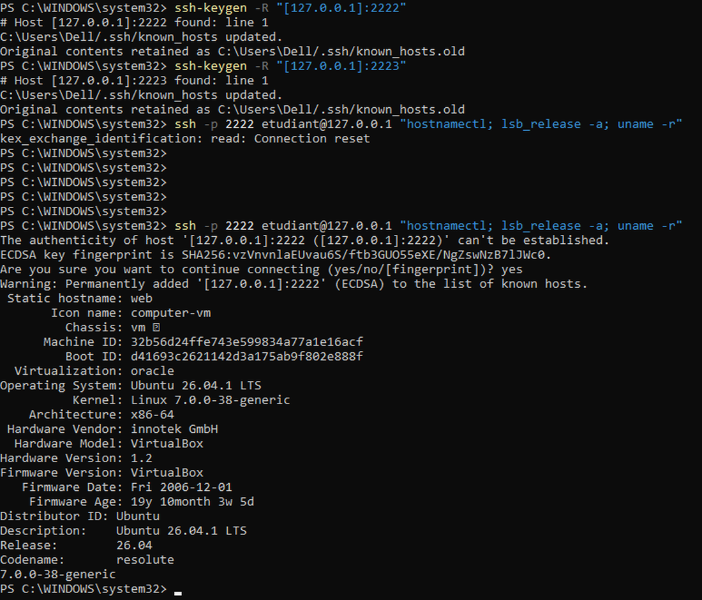

```
PS> ssh -p 2223 etudiant@127.0.0.1 "hostname; ip -4 -br addr"
client
lo               UNKNOWN        127.0.0.1/8
enp0s3           UP             10.10.0.20/24
```

*Incident 3 : commande SSH qui ne s'exécute pas.* Mes deux premières tentatives pour `client` n'ont rien renvoyé et PowerShell affichait des `>>` : il manquait le **guillemet fermant** de `"hostname; ip -4 -br addr"`, donc PowerShell attendait la suite de la commande. Je l'ai interrompu avec Ctrl + C et retapé avec les deux guillemets.

*Capture 11 : SSH vers client*

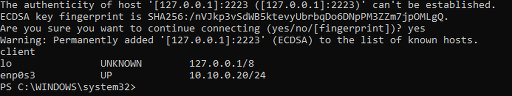

### Questions

**Q1. Combien de temps a pris le clonage de `web` ? Comparez avec la durée de l'installation d'Ubuntu au TP précédent, puis avec la mise en service d'un serveur physique.**

Le clonage de `web` a pris **101,5 secondes** (soit 1 min 42), mesurées avec `Measure-Command`. En revanche, je n'avais pas chronométré l'installation d'Ubuntu au TP précédent : la valeur de **35 à 40 minutes** est une **estimation** faite à partir de l'heure des captures d'écran. Même avec cette marge d'incertitude, le clonage est une vingtaine de fois plus rapide. Un serveur physique peut demander **une semaine ou plus** avant d'être utilisable : commande, livraison, montage en baie, câblage, installation du système. On compte donc en **jours, voire en semaines**. Le clonage à partir d'une image illustre l'un des gains du cloud IaaS : on obtient une machine prête en quelques minutes, sans réinstaller le système.

**Q2. Pourquoi faut-il changer le nom d'hôte, l'identifiant de machine et les clés SSH d'un clone ? Quel risque y aurait-il à garder les mêmes clés SSH sur 50 serveurs ?**

Il faut tout changer pour que **chaque machine ait sa propre identité** et que l'on s'y retrouve. Un clone est une copie exacte : sans changement, 50 serveurs auraient le même nom et le même identifiant de machine. On ne pourrait plus savoir quelle machine a produit tel journal ou telle donnée, ce qui crée des **collisions** et des **mélanges** dans les journaux, la supervision et l'inventaire, et on risquerait de **se tromper nous-mêmes** en administrant la mauvaise machine. Pour les clés SSH, garder les mêmes sur 50 serveurs **baisse le niveau de sécurité** : la même clé privée serait copiée 50 fois, donc si elle est volée sur une seule machine, l'attaquant peut se faire passer pour n'importe lequel des 50 serveurs, et le client SSH ne verrait aucune différence. Dans le cloud, c'est **cloud-init** qui fait ces changements automatiquement au premier démarrage d'une instance.

**Q3. Relevez la version d'Ubuntu, le noyau, le nombre de vCPU et la RAM de `web`. Quel service cloud joue le rôle de `ubuntu-srv` ?**

| Élément | Valeur relevée pour `web` |
|---|---|
| Version d'Ubuntu | **26.04.1 LTS** (nom de code *resolute*) |
| Noyau | **Linux 7.0.0-38-generic** |
| vCPU | **1** |
| RAM | **1024 Mo** |

`ubuntu-srv` joue le rôle d'une **image de machine**, comme une **AMI** chez AWS (ou une *image* personnalisée chez Azure) : un modèle à partir duquel on lance autant d'instances que l'on veut. `web` et `client` sont les **instances** créées à partir de cette image.

---

## Partie 2 — Relier les VM en réseau

Connexion SSH à `client` depuis l'hôte (`ssh -p 2223 etudiant@127.0.0.1`), puis tests dans `client`.

*Incident 4 : `web` éteinte.* Mon premier `ping -c 4 10.10.0.10` a échoué. Le message `From 10.10.0.20 ... Destination Host Unreachable` vient de `client` lui-même (10.10.0.20) : il a cherché `10.10.0.10` sur le réseau et personne n'a répondu. Comme la passerelle et Internet répondaient, la configuration de `client` n'était pas en cause : la VM `web` était **éteinte**. Je l'ai démarrée, et le ping a ensuite réussi.

```
etudiant@client:~$ ping -c 4 10.10.0.10          (web éteinte)
PING 10.10.0.10 (10.10.0.10) 56(84) bytes of data.
From 10.10.0.20 icmp_seq=1 Destination Host Unreachable
From 10.10.0.20 icmp_seq=2 Destination Host Unreachable
From 10.10.0.20 icmp_seq=3 Destination Host Unreachable
From 10.10.0.20 icmp_seq=4 Destination Host Unreachable
4 packets transmitted, 0 received, +4 errors, 100% packet loss, time 3087ms

etudiant@client:~$ ping -c 2 10.10.0.1
64 bytes from 10.10.0.1: icmp_seq=1 ttl=64 time=0.943 ms
64 bytes from 10.10.0.1: icmp_seq=2 ttl=64 time=0.591 ms
2 packets transmitted, 2 received, 0% packet loss, time 1001ms
rtt min/avg/max/mdev = 0.591/0.767/0.943/0.176 ms

etudiant@client:~$ ping -c 2 1.1.1.1
64 bytes from 1.1.1.1: icmp_seq=1 ttl=64 time=5.46 ms
64 bytes from 1.1.1.1: icmp_seq=2 ttl=64 time=17.5 ms
2 packets transmitted, 2 received, 0% packet loss, time 1002ms
rtt min/avg/max/mdev = 5.461/11.496/17.531/6.035 ms
```

*Capture 12 : Ping vers web (échec), la passerelle et Internet*

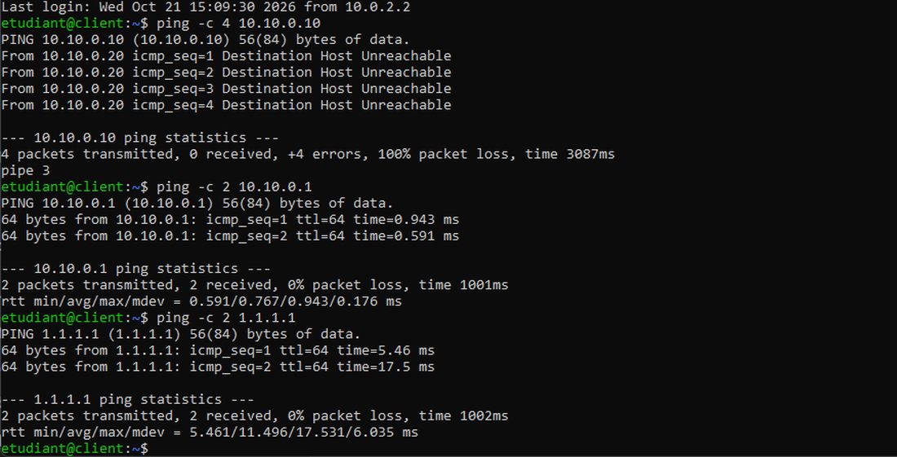

```
etudiant@client:~$ ip route
default via 10.10.0.1 dev enp0s3 proto static
10.10.0.0/24 dev enp0s3 proto kernel scope link src 10.10.0.20
etudiant@client:~$ resolvectl status | grep "DNS Servers"
       DNS Servers: 10.10.0.1 1.1.1.1
```

(Une faute de frappe, `ip routes`, a donné « Object "routes" is unknown » ; elle a été corrigée aussitôt.)

*Capture 13 : Table de routage et serveurs DNS de client*

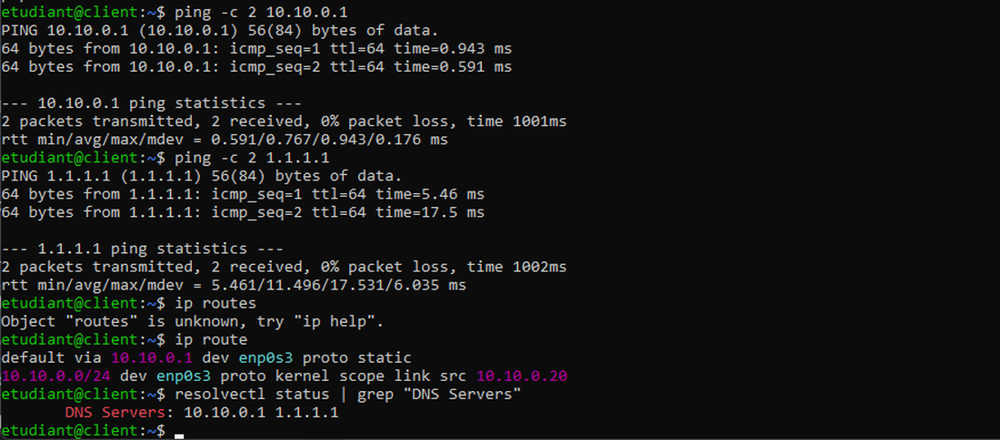

Après avoir démarré `web` :

```
etudiant@client:~$ ping -c 4 10.10.0.10
64 bytes from 10.10.0.10: icmp_seq=1 ttl=64 time=4.26 ms
64 bytes from 10.10.0.10: icmp_seq=2 ttl=64 time=2.63 ms
64 bytes from 10.10.0.10: icmp_seq=3 ttl=64 time=2.31 ms
64 bytes from 10.10.0.10: icmp_seq=4 ttl=64 time=1.76 ms
4 packets transmitted, 4 received, 0% packet loss, time 3004ms
rtt min/avg/max/mdev = 1.761/2.738/4.255/0.928 ms
```

*Capture 14 : Ping de client vers web réussi*

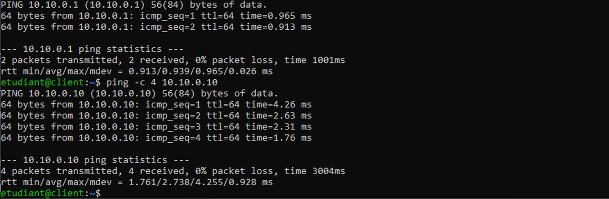

**Nom de `web` dans `/etc/hosts`, puis test par le nom :**

```
etudiant@client:~$ echo "10.10.0.10 web" | sudo tee -a /etc/hosts
10.10.0.10 web
etudiant@client:~$ ping -c 2 web
PING web (10.10.0.10) 56(84) bytes of data.
64 bytes from web (10.10.0.10): icmp_seq=1 ttl=64 time=2.01 ms
64 bytes from web (10.10.0.10): icmp_seq=2 ttl=64 time=1.21 ms
2 packets transmitted, 2 received, 0% packet loss, time 1002ms
rtt min/avg/max/mdev = 1.205/1.606/2.008/0.401 ms
```

*Capture 15 : Ping de client vers web par son nom*

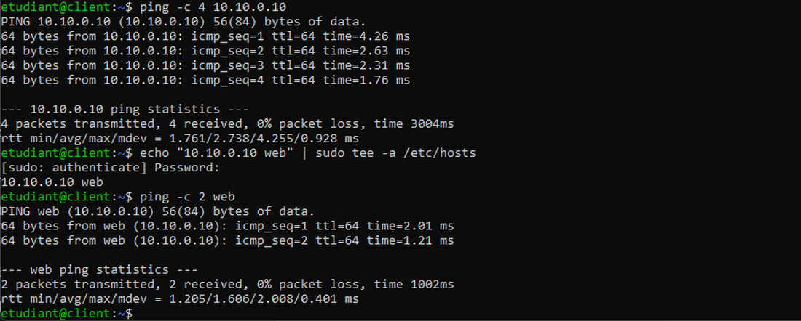

**Depuis Windows :**

```
PS> ping -n 2 10.10.0.10

Envoi d'une requête 'Ping'  10.10.0.10 avec 32 octets de données :
Délai d'attente de la demande dépassé.
Délai d'attente de la demande dépassé.

Statistiques Ping pour 10.10.0.10:
    Paquets : envoyés = 2, reçus = 0, perdus = 2 (perte 100%),

PS> ssh -p 2222 etudiant@127.0.0.1 "hostname"
web
```

*Capture 16 : Ping depuis Windows (échec) et SSH par le port 2222 (réussi)*

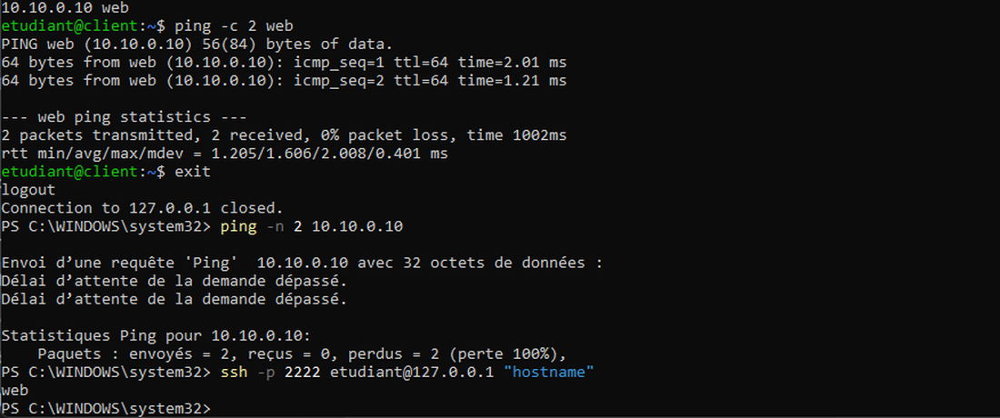

### Questions

**Q1. Les deux VM sont-elles dans le même sous-réseau ? Justifiez avec leurs adresses et le masque /24.**

Oui. `web` a l'adresse **10.10.0.10/24** et `client` **10.10.0.20/24**. Le masque `/24` (255.255.255.0) signifie que les **24 premiers bits**, donc les trois premiers nombres, désignent le réseau. Ici, les deux adresses commencent par **10.10.0**, donc elles appartiennent au même réseau **10.10.0.0/24** (adresses utilisables de 10.10.0.1 à 10.10.0.254). C'est pourquoi `client` joint `web` directement, sans passer par la passerelle : sa table de routage contient la ligne `10.10.0.0/24 dev enp0s3 scope link`.

**Q2. Quelle est la passerelle par défaut de `client` ? Quel est son rôle ? À quel élément d'un VPC (AWS) ou d'un VNet (Azure) correspond-elle ?**

La passerelle par défaut est **10.10.0.1** (ligne `default via 10.10.0.1` de `ip route`). Son rôle est d'être la **porte de sortie** du réseau : tout paquet destiné à une adresse qui n'est pas dans 10.10.0.0/24 (par exemple 1.1.1.1) est envoyé à la passerelle, qui le transmet ailleurs. Ici, c'est le routeur NAT de VirtualBox qui joue ce rôle. Dans le cloud, elle correspond au **routeur du VPC** d'AWS, dont la route par défaut (0.0.0.0/0) mène vers une *Internet Gateway* ou une *NAT Gateway*, et à la **passerelle par défaut du sous-réseau** d'un VNet Azure (routage système vers Internet).

**Q3. Quel est le temps de réponse moyen du ping de `client` vers `web` ? Pourquoi est-il si faible ?**

Le temps moyen est de **2,738 ms** (minimum 1,761 ms, maximum 4,255 ms) ; en passant par le nom `web`, il est de 1,606 ms. Il est très faible parce que les deux VM sont sur le **même ordinateur physique** et que le réseau `tp-cloud` est **virtuel** : les paquets ne passent par aucun câble, aucun vrai commutateur, et ne parcourent aucune distance, ils sont simplement échangés en mémoire par VirtualBox. Pour comparaison, le ping vers Internet (1.1.1.1) est plus lent (11,5 ms en moyenne) car il sort de l'ordinateur et traverse de vrais réseaux.

**Q4. Le ping depuis Windows vers 10.10.0.10 aboutit-il ? Pourquoi ? Comment l'hôte arrive-t-il malgré tout à joindre `web` en SSH ?**

Non : **100 % de perte** (« Délai d'attente de la demande dépassé »). Le réseau `tp-cloud` est un réseau **privé et isolé**, créé par VirtualBox : Windows n'a aucune route vers `10.10.0.0/24` et ne peut pas atteindre ces adresses directement, comme un VPC est inaccessible depuis Internet par défaut. L'hôte arrive pourtant à joindre `web` en SSH grâce à la **redirection de port** (*port forwarding*) configurée à la partie 1 : la règle `ssh-web` envoie tout ce qui arrive sur `127.0.0.1:2222` vers `10.10.0.10:22`. Seul le port 22 (TCP) est redirigé : le ping (protocole ICMP) ne l'est pas, d'où son échec. Dans le cloud, l'équivalent est d'exposer volontairement un service par une adresse IP publique ou un équilibreur de charge, avec des règles qui précisent quels ports sont ouverts.

---

## Partie 3 — Publier une page web et la protéger

### 3.1 Installer Nginx

Connexion à `web` (`ssh -p 2222 etudiant@127.0.0.1`), puis installation de Nginx (version 1.28.3, via Internet) et création de la page d'accueil.

```
etudiant@web:~$ sudo apt update && sudo apt install -y nginx
...
Created symlink '/etc/systemd/system/multi-user.target.wants/nginx.service' → '/usr/lib/systemd/system/nginx.service'.
etudiant@web:~$ systemctl status nginx --no-pager
● nginx.service - A high performance web server and a reverse proxy server
     Loaded: loaded (/usr/lib/systemd/system/nginx.service; enabled; preset: enabled)
     Active: active (running) since Wed 2026-10-28 01:55:49 UTC
   Main PID: 1774 (nginx)
      Tasks: 2 (limit: 412)
     Memory: 2.3M (peak: 5.1M)
     CGroup: /system.slice/nginx.service
             ├─1774 "nginx: master process /usr/sbin/nginx -g daemon on; master_process on;"
             └─1776 "nginx: worker process"
```

*Capture 17 : Nginx actif (active (running))*

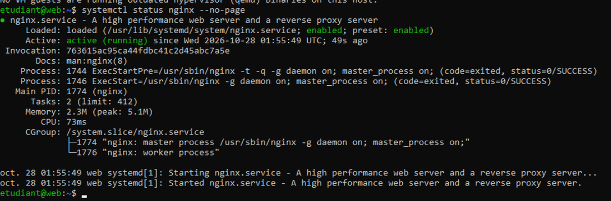

*Incident 5 : accents illisibles dans le navigateur.* J'ai d'abord créé la page avec `echo "<h1>Binôme ... </h1>" | sudo tee /var/www/html/index.html`. Dans le terminal, le texte était correct, mais Edge affichait `Binôme` et `première`. Le fichier est en UTF-8, mais la page ne **déclarait pas** son encodage : le navigateur l'a lu en Windows-1252, ce qui transforme chaque lettre accentuée en deux caractères. J'ai corrigé en ajoutant `<meta charset="utf-8">` au début de la page. (Au passage, j'avais aussi tapé `EXIT` en majuscules, ce qui a donné `command not found` : sous Linux, les commandes sont sensibles à la casse.)

*Capture 18 : Page avec accents illisibles*


```
etudiant@web:~$ echo '<meta charset="utf-8"><h1>Binôme TRA BI TRA CHRISTIAN DAVID - KOUADIO BOFFOUO : ma première VM en réseau</h1>' | sudo tee /var/www/html/index.html
<meta charset="utf-8"><h1>Binôme TRA BI TRA CHRISTIAN DAVID - KOUADIO BOFFOUO : ma première VM en réseau</h1>
PS> ssh -p 2223 etudiant@127.0.0.1 "curl -s http://web"
<h1>Binôme TRA BI TRA CHRISTIAN DAVID - KOUADIO BOFFOUO : ma première VM en réseau</h1>
```

La page s'affiche ensuite correctement dans le navigateur de l'hôte, à l'adresse `http://127.0.0.1:8080` (redirection de port `http-web`).

*Capture 19 : Page affichée correctement sur 127.0.0.1:8080*


### 3.2 Fermer puis ouvrir le port 80 avec ufw

**Pare-feu activé avec SSH seulement.** J'ai autorisé OpenSSH **avant** d'activer le pare-feu, pour ne pas perdre l'accès SSH :

```
etudiant@web:~$ sudo ufw allow OpenSSH
Rules updated
Rules updated (v6)
etudiant@web:~$ sudo ufw enable
Command may disrupt existing ssh connections. Proceed with operation (y|n)? y
Firewall is active and enabled on system startup
etudiant@web:~$ sudo ufw status verbose
Status: active
Logging: on (low)
Default: deny (incoming), allow (outgoing), disabled (routed)
New profiles: skip

To                         Action      From
--                         ------      ----
22/tcp (OpenSSH)           ALLOW IN    Anywhere
22/tcp (OpenSSH (v6))      ALLOW IN    Anywhere (v6)
```

*Capture 20 : ufw actif avec la seule règle OpenSSH*

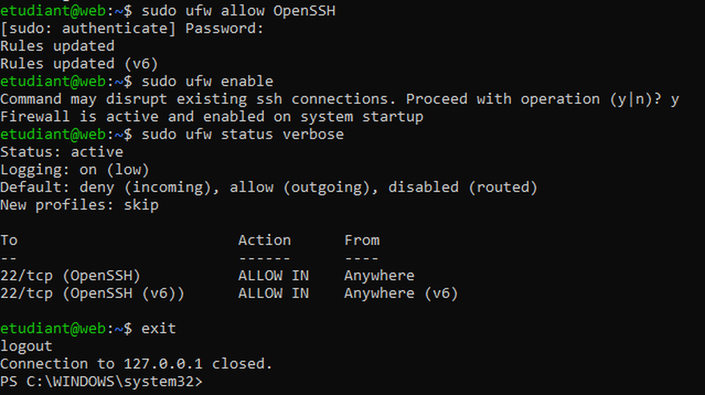

**Test avec le port 80 fermé :**

```
PS> ssh -p 2223 etudiant@127.0.0.1 "curl -m 5 http://web; echo code retour: `$?"
curl: (28) Connection timed out after 5002 milliseconds
code retour: 28
```

*Capture 21 : curl avec le port 80 fermé : délai dépassé, code 28*

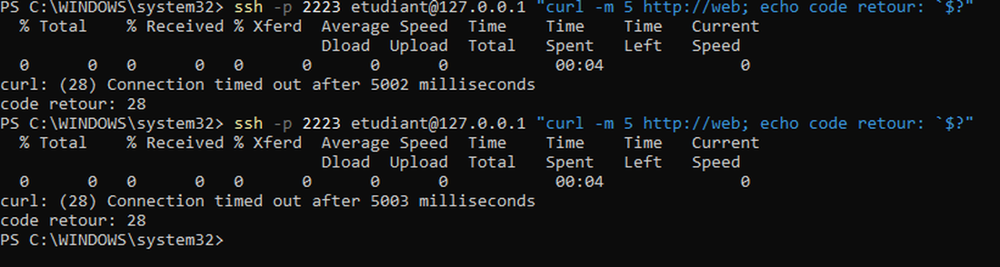

Dans le navigateur, la page ne s'affiche plus : Edge affiche « Désolé, impossible d'accéder à cette page » avec le code `ERR_CONNECTION_RESET`.

*Capture 22 : Navigateur : page inaccessible avec le port 80 fermé*

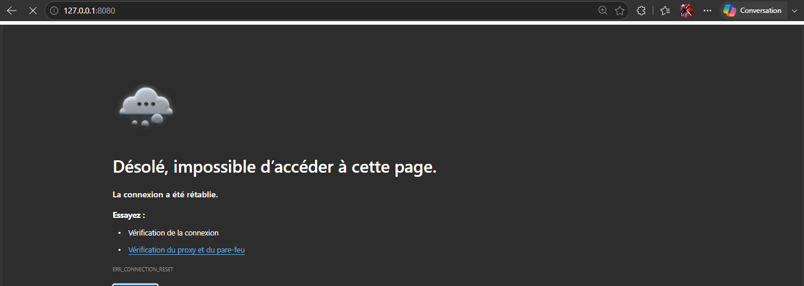

**Ouverture du port HTTP :**

```
etudiant@web:~$ sudo ufw allow 'Nginx HTTP'
Rule added
Rule added (v6)
etudiant@web:~$ sudo ufw status numbered
Status: active

     To                         Action      From
     --                         ------      ----
[ 1] OpenSSH                    ALLOW IN    Anywhere
[ 2] Nginx HTTP                 ALLOW IN    Anywhere
[ 3] OpenSSH (v6)               ALLOW IN    Anywhere (v6)
[ 4] Nginx HTTP (v6)            ALLOW IN    Anywhere (v6)

etudiant@web:~$ sudo ss -tlnp
State   Recv-Q  Send-Q   Local Address:Port    Peer Address:Port   Process
LISTEN  0       4096        127.0.0.54:53           0.0.0.0:*     users:(("systemd-resolve",pid=561,fd=19))
LISTEN  0       4096     127.0.0.53%lo:53           0.0.0.0:*     users:(("systemd-resolve",pid=561,fd=17))
LISTEN  0       4096           0.0.0.0:22           0.0.0.0:*     users:(("sshd",pid=1334,fd=3),("systemd",pid=1,fd=87))
LISTEN  0       511            0.0.0.0:80           0.0.0.0:*     users:(("nginx",pid=1776,fd=5),("nginx",pid=1774,fd=5))
LISTEN  0       4096              [::]:22              [::]:*     users:(("sshd",pid=1334,fd=4),("systemd",pid=1,fd=88))
LISTEN  0       511               [::]:80              [::]:*     users:(("nginx",pid=1776,fd=6),("nginx",pid=1774,fd=6))
```

*Capture 23 : Règles ufw et ports en écoute*

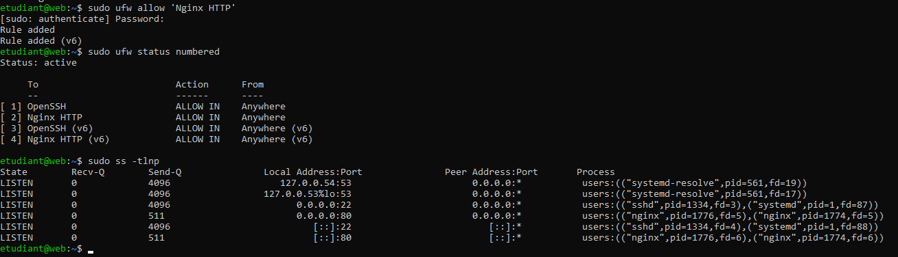

```
PS> ssh -p 2223 etudiant@127.0.0.1 "curl -s http://web"
<meta charset="utf-8"><h1>Binôme TRA BI TRA CHRISTIAN DAVID - KOUADIO BOFFOUO : ma première VM en réseau</h1>
```

*Capture 24 : curl fonctionne à nouveau*

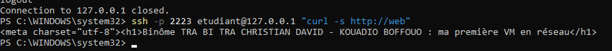

*Capture 25 : Page affichée de nouveau dans le navigateur*


### Questions

**Q1. Que renvoie `curl` quand le port 80 est fermé (message et code retour) ? Pourquoi le navigateur reste-t-il bloqué au lieu d'afficher une erreur immédiate ?**

`curl` renvoie **`curl: (28) Connection timed out after 5002 milliseconds`** avec le **code retour 28** (même résultat à la deuxième tentative : 5003 ms). Le code 28 signifie « délai dépassé ». Le pare-feu applique sa règle par défaut `deny (incoming)` en **ignorant silencieusement** les paquets : il ne renvoie ni réponse, ni refus. Le client ne sait donc pas si le serveur est absent, lent ou protégé, et il attend jusqu'au bout de son délai. Si le port était simplement fermé sans pare-feu, le serveur répondrait tout de suite « connexion refusée » et l'erreur serait immédiate. Dans mon test, `curl` a attendu **5 secondes** (limite fixée par `-m 5`, 5002 ms mesurées) avant d'abandonner. Edge est resté en attente un moment que je n'ai pas chronométré avant d'afficher `ERR_CONNECTION_RESET`. Le navigateur ne parle pas directement à `web` : il passe par VirtualBox (redirection `127.0.0.1:8080` vers `10.10.0.10:80`), qui attend la réponse puis abandonne et ferme la connexion (explication probable, non vérifiée par un test).

**Q2. Sur quel port et sur quelles adresses Nginx écoute-t-il ?**

D'après `ss -tlnp`, Nginx écoute sur le **port 80 (TCP)**, aux adresses **`0.0.0.0:80`** (toutes les adresses IPv4 de la machine) et **`[::]:80`** (toutes les adresses IPv6). Les processus sont le master (PID 1774) et le worker (PID 1776). Il écoute donc sur toutes les interfaces, et non seulement sur `127.0.0.1` : c'est le **pare-feu**, et non Nginx, qui décide qui peut le joindre.

**Q3. `ufw` joue ici le rôle d'un groupe de sécurité du cloud. Donnez deux ressemblances et une différence.**

*Ressemblances :* (1) Les deux filtrent le trafic **par port et par protocole**, avec une politique par défaut qui **bloque le trafic entrant** et des règles `allow` qui ouvrent seulement ce qui est nécessaire (ici SSH, puis HTTP). (2) Les deux autorisent le trafic **sortant** par défaut et sont **à état** : la réponse à une connexion autorisée repasse sans règle supplémentaire.

*Différence :* `ufw` est un logiciel **à l'intérieur de la VM**, géré par son administrateur, qui peut le désactiver (`ufw disable`). Un groupe de sécurité est appliqué **à l'extérieur de l'instance**, au niveau du réseau virtuel du fournisseur, géré par l'API du cloud, et peut être attaché à plusieurs instances à la fois. Même un administrateur qui se connecte à la VM ne peut pas le modifier depuis l'intérieur.

**Q4. Dans ce TP, vous êtes le client d'un service IaaS. Quelles couches avez-vous gérées vous-même, et lesquelles VirtualBox a-t-il fournies ?** *(à adapter au vocabulaire du tableau « Qui gère quoi ? » de ton cours)*

*Fournies par VirtualBox (le « fournisseur ») :* la **machine physique** (mon PC), la **virtualisation** (l'hyperviseur), le **matériel virtuel** (vCPU, RAM, disque, carte réseau) et le **réseau virtuel** (`tp-cloud`, sa passerelle, le NAT et les redirections de port).

*Gérées par moi (le « client ») :* le **système d'exploitation** (Ubuntu : nom d'hôte, adresse IP fixe avec netplan, mises à jour), la **sécurité au niveau du système** (pare-feu `ufw`, clés SSH), le **logiciel** (Nginx), et le **contenu** (la page `index.html`).

---

## Partie 4 — Mesurer et nettoyer

### 4.1 Mesures vues de l'intérieur de `web`

```
PS> ssh -p 2222 etudiant@127.0.0.1 "free -h; df -h /; nproc"
               total        used        free      shared  buff/cache   available
Mem:           956Mi       237Mi        83Mi       1,0Mi       656Mi       718Mi
Swap:          2,0Gi        12Ki       2,0Gi
Filesystem                         Size  Used Avail Use% Mounted on
/dev/mapper/ubuntu--vg-ubuntu--lv   12G  5,2G  5,6G  49% /
1
```

*Capture 26 : Mesures vues de l'intérieur de web*

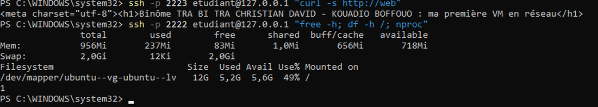

### 4.2 Mesures vues de l'hôte

Le Gestionnaire des tâches (onglet Détails) montre six processus `VirtualBoxVM.exe`, dont deux seulement sont gros : environ 1 136 864 Ko et 751 604 Ko.

*Capture 27 : Processus VirtualBoxVM.exe dans le Gestionnaire des tâches*

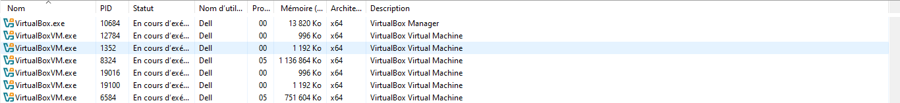

Pour savoir quel processus correspond à quelle VM, j'ai utilisé `Get-Process`, qui affiche le titre de la fenêtre :

```
PS> Get-Process VirtualBoxVM | Select-Object Id, MainWindowTitle, @{n="Mo";e={[int]($_.WorkingSet64/1MB)}}

   Id MainWindowTitle                            Mo
   -- ---------------                            --
 1352                                              5
 6584 client [En fonction] - Oracle VirtualBox   781
 8324 web [En fonction] - Oracle VirtualBox     1158
12784                                              8
19016                                              8
19100                                              5
```

Taille des dossiers des VM et du fichier disque de `web` :

```
PS> Get-ChildItem "$HOME\VirtualBox VMs" -Directory | ForEach-Object { ... }
client : 6,28 Go
ubuntu-srv : 7,29 Go
web : 6,31 Go

PS> VBoxManage list hdds        (extrait)
Location:       C:\Users\Dell\VirtualBox VMs\web\web.vdi
Type:           normal (base)
Storage format: VDI
Capacity:       25600 MBytes
Location:       C:\Users\Dell\VirtualBox VMs\client\client.vdi
Capacity:       25600 MBytes

PS> "{0:N2} Go" -f ((Get-Item "$HOME\VirtualBox VMs\web\web.vdi").Length / 1GB)
6,30 Go
```

*Capture 28 : Taille des dossiers des VM*

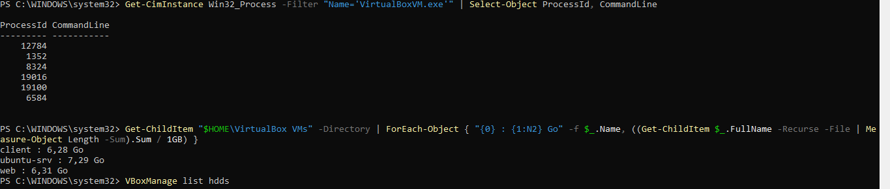

*Capture 29 : Disques virtuels (VBoxManage list hdds)*

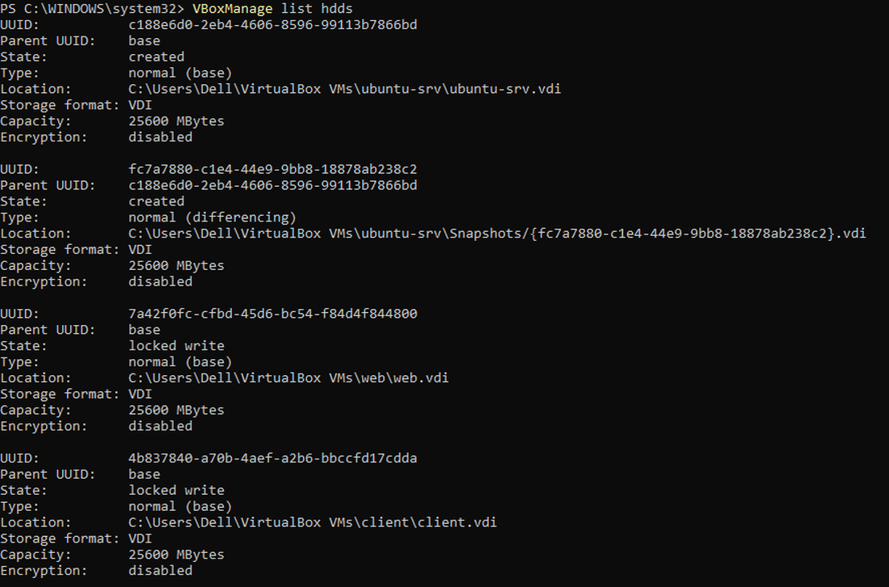

*Capture 30 : Mémoire par VM et taille de web.vdi*

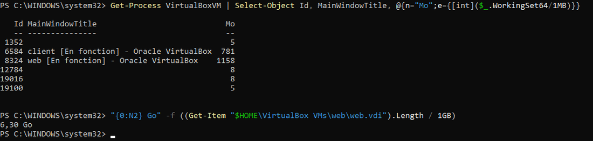

### 4.3 Arrêt et nettoyage

```
PS> VBoxManage controlvm web acpipowerbutton
PS> VBoxManage controlvm client acpipowerbutton
PS> VBoxManage list runningvms
(aucune ligne : les deux VM sont éteintes)
PS> VBoxManage startvm web --type headless
Waiting for VM "web" to power on...
VM "web" has been successfully started.
PS> VBoxManage list runningvms
"web" {e7468458-f837-4360-bc89-b9ad6a345334}
PS> VBoxManage controlvm web poweroff
0%...10%...20%...30%...40%...50%...60%...70%...80%...90%...100%
PS> VBoxManage unregistervm web --delete
0%...10%...20%...30%...40%...50%...60%...70%...80%...90%...100%
PS> VBoxManage unregistervm client --delete
0%...10%...20%...30%...40%...50%...60%...70%...80%...90%...100%
PS> VBoxManage natnetwork remove --netname tp-cloud
PS> VBoxManage list vms
"ubuntu-srv" {1a1fc102-b4b6-49da-8871-fb0dfeafdeea}
```

*Incident 6 : faute de frappe.* Ma première commande de suppression de `web` contenait `--delet` au lieu de `--delete`. VirtualBox a répondu `error: unknown option: --delet` et a affiché l'aide de la commande ; je n'ai rien perdu et j'ai retapé la commande correctement.

À la fin, **seule `ubuntu-srv` reste** : elle sert d'image de base pour les prochains TP.

*Capture 31 : Nettoyage : seule ubuntu-srv reste*

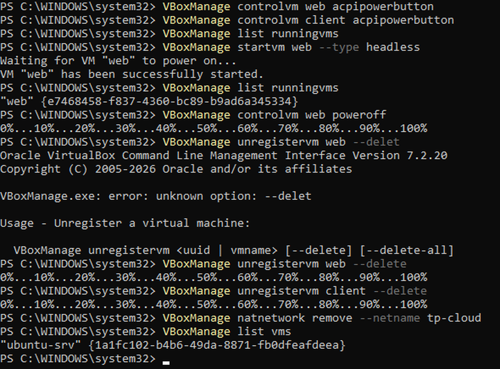

### Questions

**Q1. La VM `web` voit-elle 1 Go de RAM ? Combien en consomme-t-elle réellement sur l'hôte ? Comment expliquez-vous l'écart ?**

`web` est configurée avec 1024 Mo et en voit **956 Mi** (`free -h`) : le noyau en réserve une petite partie pour lui-même. Sur l'hôte, le processus de `web` occupe **1158 Mo** (`Get-Process`, 8324), alors que celui de `client`, moins sollicitée, n'en occupe que **781 Mo** (6584). Le Gestionnaire des tâches donne des valeurs voisines (environ 1,08 Go et 734 Mo) : ce sont deux façons de mesurer la mémoire d'un même processus. Je retiens trois explications. (1) VirtualBox n'alloue la mémoire de la VM qu'**au fur et à mesure** qu'elle s'en sert : `client`, qui a peu travaillé, n'a pas encore touché toute sa RAM. (2) Ce que la VM utilise (237 Mi) **et son cache** (656 Mi) sont de la mémoire occupée vue de l'hôte. (3) VirtualBox ajoute sa **propre consommation** (émulation des cartes réseau et du disque, mémoire vidéo), ce qui peut faire dépasser 1 Go au processus de `web`.

**Q2. Le disque d'un clone fait 25 Go pour la VM. Quelle place occupe-t-il réellement sur l'hôte ? Pourquoi ?**

Le disque virtuel de `web` a une capacité de **25600 Mo (25 Go)**, mais le fichier `web.vdi` n'occupe que **6,30 Go** sur l'hôte (6,31 Go pour le dossier entier). `client` est dans le même cas (6,28 Go). Le format **VDI dynamique** n'occupe que les blocs réellement écrits : la VM croit disposer de 25 Go, mais l'hôte n'en réserve qu'au fur et à mesure des besoins. C'est le principe du **provisionnement léger** (*thin provisioning*). Les clones sont des copies complètes (type `normal (base)`) : chacun a ses propres données, d'où trois dossiers de 6 à 7 Go, soit environ 20 Go au total. Dans le cloud, on est en général facturé pour la **taille demandée** du disque, et non pour la place réellement remplie.

**Q3. Quelle différence entre `acpipowerbutton`, `poweroff` et `unregistervm --delete` ?**

- **`acpipowerbutton`** simule l'**appui sur le bouton d'alimentation** : l'OS de la VM reçoit un signal et s'éteint **proprement** (arrêt des services, écriture des données sur le disque). C'est l'arrêt normal.
- **`poweroff`** coupe la VM **brutalement et immédiatement**, comme si on débranchait le câble d'alimentation. Les données non écrites peuvent être perdues ou corrompues. On l'utilise quand l'arrêt propre ne marche pas, ou, comme ici, avant de supprimer la VM.
- **`unregistervm --delete`** ne concerne pas l'état de la VM : il la **retire de VirtualBox et supprime ses fichiers** (configuration et disque `.vdi`). C'est **irréversible**. Sans `--delete`, la VM disparaît de la liste mais ses fichiers restent sur le disque.

Équivalents cloud : arrêter une instance (*stop*), l'arrêter de force (*force stop*) et la **terminer** (*terminate*).

**Q4. Dans le cloud, une VM arrêtée est-elle encore facturée ?**

En général, **le calcul (vCPU et RAM) n'est plus facturé** quand l'instance est arrêtée, mais **ce qui continue d'exister est encore facturé** : le **disque** (volume EBS chez AWS, disque managé chez Azure), qui garde les données, et l'**adresse IP publique** (une IP statique ou élastique réservée peut aussi être facturée). Sur Azure, il faut **désallouer** la VM, et pas seulement l'arrêter depuis le système, pour arrêter la facturation du calcul. Pour ne plus rien payer, il faut **supprimer** la ressource (*terminate*, qui correspond à notre `unregistervm --delete`), puis les disques et les adresses IP associés. Les règles de facturation changent selon le fournisseur et l'offre : il faut vérifier sa grille tarifaire.

---

## Difficultés rencontrées et solutions

| N° | Problème | Cause | Solution | Ce que j'en retiens |
|---|---|---|---|---|
| 1 | Saisie du fichier netplan qui ne s'annule pas | J'ai appuyé sur la Ctrl droite, qui est la **touche hôte** de VirtualBox | Ctrl **gauche** + C | Connaître la touche hôte de son hyperviseur |
| 2 | Fichier YAML refusé ou mal écrit | Lignes sans indentation, `network :` et `-to:` mal formés | Retaper avec les bons espaces et vérifier avec `cat` | En YAML, les espaces font partie de la syntaxe |
| 3 | `netplan apply` : *Cannot find unique matching interface* | L'ancien fichier `00-installer-config.yaml` désignait la carte par l'**ancienne adresse MAC** d'`ubuntu-srv` | Le renommer en `.bak` | Un clone a une nouvelle MAC : il faut aussi nettoyer la configuration héritée |
| 4 | Mauvaise hypothèse de départ | J'ai d'abord soupçonné un nom d'interface différent | `ip -br link` a montré que la carte s'appelait bien `enp0s3` | Vérifier une hypothèse avant de modifier |
| 5 | `Connection reset` en SSH | `web` finissait de redémarrer | Attendre 30 secondes | Un service met un moment à être prêt |
| 6 | Commande SSH qui ne s'exécute pas (`>>`) | Guillemet fermant oublié dans PowerShell | Ctrl + C et retaper | Les `>>` signalent une commande inachevée |
| 7 | `Destination Host Unreachable` vers `web` | `web` était **éteinte** (le message vient de `client` lui-même) | La démarrer | Lire d'où vient un message d'erreur |
| 8 | Accents illisibles (`Binôme`) dans le navigateur | Page sans déclaration d'encodage | Ajouter `<meta charset="utf-8">` | Toujours déclarer l'encodage d'une page |
| 9 | Petites fautes de frappe | `EXIT` en majuscules, `ip routes`, `99-tp/yaml`, `--delet` | Retaper correctement | Sous Linux, les commandes sont sensibles à la casse |

## Lien avec le cloud

| Dans le TP (VirtualBox) | Équivalent dans le cloud |
|---|---|
| `ubuntu-srv` | Image de machine (AMI chez AWS, image chez Azure) |
| `VBoxManage clonevm` | Lancer une instance à partir d'une image |
| Personnalisation à la main | `cloud-init` au premier démarrage |
| Réseau `tp-cloud` 10.10.0.0/24 | Réseau privé (VPC et sous-réseau, ou VNet) |
| Passerelle 10.10.0.1 | Routeur du VPC, route par défaut |
| Redirection de port | IP publique, NAT ou équilibreur de charge avec règle entrante |
| `ufw allow` | Règle d'un groupe de sécurité |
| `acpipowerbutton` / `poweroff` / `unregistervm --delete` | Arrêter / forcer l'arrêt / **terminer** l'instance |
| Disque VDI dynamique | Provisionnement léger du stockage |

## Aide-mémoire des commandes

| Commande | À quoi elle sert |
|---|---|
| `VBoxManage clonevm ubuntu-srv --name web --register` | Cloner une VM |
| `VBoxManage natnetwork add --netname tp-cloud --network "10.10.0.0/24" --dhcp off` | Créer un réseau NAT sans DHCP |
| `--port-forward-4 "nom:tcp:[127.0.0.1]:2222:[10.10.0.10]:22"` | Ajouter une redirection de port |
| `sudo hostnamectl set-hostname web` | Changer le nom de la machine |
| `sudo netplan apply` | Appliquer la configuration réseau |
| `ip -4 addr show enp0s3`, `ip route` | Voir l'adresse IP et la table de routage |
| `ping -c 4 10.10.0.10` | Tester la joignabilité et la latence |
| `ssh -p 2222 etudiant@127.0.0.1` | Se connecter à `web` depuis l'hôte |
| `sudo apt install -y nginx`, `systemctl status nginx` | Installer et vérifier Nginx |
| `curl -m 5 http://web` | Tester la page avec un délai maximum |
| `sudo ufw allow OpenSSH`, `sudo ufw enable`, `sudo ufw allow 'Nginx HTTP'` | Configurer le pare-feu (SSH d'abord) |
| `sudo ss -tlnp` | Voir les ports en écoute |
| `free -h`, `df -h /`, `nproc` | Mesurer RAM, disque et processeurs |
| `VBoxManage unregistervm web --delete` | Supprimer une VM et ses fichiers |

## Conclusion

Ce TP m'a permis de passer d'une machine installée à la main à une petite infrastructure : j'ai cloné `web` en 101,5 secondes (contre environ 35 à 40 minutes estimées pour l'installation du TP1), puis `client` de la même façon ; je les ai personnalisées, reliées dans un réseau privé, puis j'ai publié une page web avec Nginx et vérifié l'effet d'un pare-feu : port fermé, `curl` renvoie le code 28 ; port ouvert, la page s'affiche. Les mesures de la fin montrent que la VM voit 956 Mi de RAM alors que son processus en consomme 1158 Mo sur l'hôte, et qu'un disque annoncé à 25 Go n'occupe que 6,30 Go.

Les incidents rencontrés (touche hôte, indentation du YAML, ancienne adresse MAC dans la configuration héritée, VM éteinte, encodage de la page) m'ont appris à **vérifier une hypothèse avant d'agir** et à bien lire les messages d'erreur. Ils m'ont aussi fait comprendre ce que le cloud IaaS automatise : créer une instance depuis une image, la personnaliser avec cloud-init, la placer dans un réseau privé, ouvrir seulement les ports nécessaires avec un groupe de sécurité, et payer ce qui existe encore quand on arrête une machine.

---

*Fin du compte rendu.*
